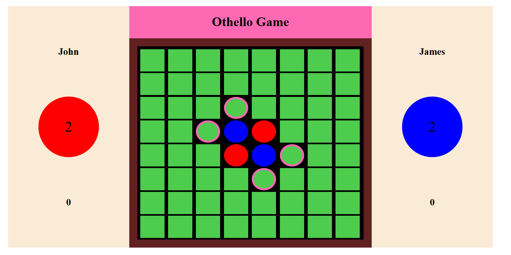

# Othello Game

A browser-based implementation of the classic Othello (Reversi) board game, built with HTML, CSS, and vanilla JavaScript. The game supports two players on an 8×8 board, with player names, score tracking, legal move highlighting, and disc-flipping mechanics.

## Preview



## Features

- **Two-player gameplay:** Play locally with another player on the same device.
- **Player names:** Enter both players' names before starting a match.
- **Interactive 8×8 board:** Select cells directly on the game board.
- **Legal move detection:** Highlight available moves for the current player.
- **Disc flipping:** Capture opponent discs by surrounding them according to Othello rules.
- **Score tracking:** Display each player's current disc count.
- **Turn management:** Alternate between players and handle turns when a player has no legal moves.
- **Game completion:** Detect when the game reaches its end and determine the final result.

## Technologies

- HTML5
- CSS3
- JavaScript (Vanilla)

No frameworks, external libraries, or package installation are required.

## Getting Started

### Prerequisites

A modern web browser, such as Google Chrome, Mozilla Firefox, Microsoft Edge, or Safari.

### Run Locally

1. Clone the repository:

   ```bash
   git clone https://github.com/AlirezaMP2003/Othello-game.git
   ```

2. Navigate to the project directory:

   ```bash
   cd Othello-game
   ```

3. Open `Othello.html` in your web browser.

No build process or development server is required for the basic local setup.

## How to Play

1. Enter the names of both players and start the game.
2. Players take turns placing their colored discs on the board.
3. A move is legal when it captures one or more opponent discs by trapping them between the newly placed disc and another disc of the current player's color.
4. Captured discs are flipped to the current player's color.
5. If a player has no legal moves, their turn must be skipped.
6. The game ends when neither player can make a legal move.
7. The player with the most discs wins.

## Project Structure

```text
Othello-game/
├── Othello.html    # Page structure and player setup
├── Othello.css     # Board layout and visual styling
├── Othello.js      # Game rules, turns, and score management
└── othello-game.png
```

## Learning Objectives

This project demonstrates practical use of:

- DOM manipulation with JavaScript.
- Event handling for interactive board cells.
- Two-dimensional arrays for representing board state.
- Conditional logic for validating moves.
- Game state management and score updates.
- CSS Grid and Flexbox for interface layout.

## Limitations

- The game is designed for local, two-player gameplay.
- There is no online multiplayer or computer-controlled opponent.
- Game progress is maintained in the current page session rather than a persistent database.
- The current layout uses fixed dimensions and may require additional work for a fully responsive mobile experience.

## Future Improvements

Potential enhancements include:

- Responsive layouts for mobile devices and tablets.
- A restart button and improved end-game dialog.
- More accessible controls and clearer turn indicators.
- Improved separation of game logic and interface code.
- Online multiplayer support.

## License

No license has been specified for this repository. Please contact the repository owner for permission to reuse or redistribute the code.
